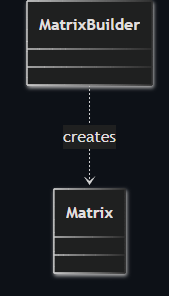
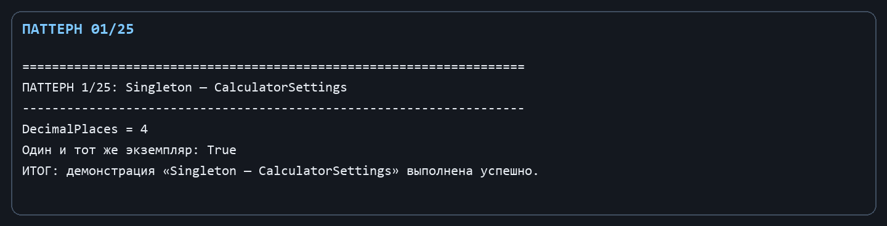
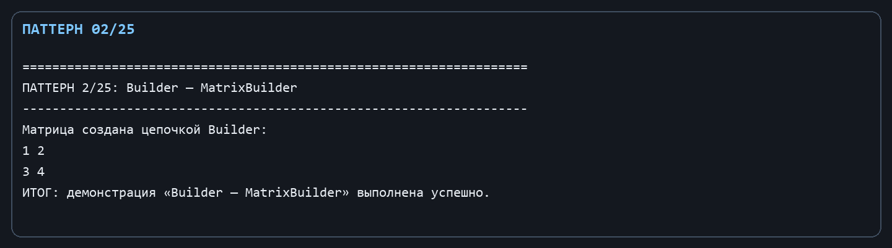

Лабораторная работа № 1. Порождающие паттерны: Одиночка и Строитель

Цель: Научиться управлять созданием общих настроек приложения и пошаговым формированием матрицы.

Git репозиторий - [https://github.com/DocesForg/Pattern_MatriCalculator](https://github.com/DocesForg/Pattern_MatriCalculator)

Вариант 6:  Разработка приложения «Матричный калькулятор»

Реализация и принцип работы

CalculatorSettings - одиночка: закрытый конструктор не допускает создание экземпляров извне, а статическое свойство Instance возвращает один объект на всё приложение. В нём хранится параметр количества знаков после запятой. MatrixBuilder - строитель: создаётся с размерами будущей матрицы, метод WithValue заполняет одну ячейку и возвращает того же строителя для цепочки вызовов, а Build создаёт итоговый неизменяемый Matrix.

Клиент получает настройки через CalculatorSettings.Instance. Для построения матрицы он вызывает new MatrixBuilder(2, 2).WithValue(...).Build(). Локальный массив остаётся деталью строителя, а конструктор Matrix дополнительно клонирует его, поэтому завершённый объект не может быть изменён через строитель.

На диаграмме показан один класс настроек без наследников: он представляет единственный экземпляр, к которому приложение обращается для получения и изменения общих настроек.

На диаграмме показана последовательность от строителя к матрице: строитель накапливает значения и в результате создаёт готовый объект Matrix.

Полный листинг

public sealed class CalculatorSettings

{

private CalculatorSettings() { }

public static CalculatorSettings Instance { get; } = new();

public int DecimalPlaces { get; set; } = 6;

}

public sealed class MatrixBuilder

{

private readonly double[,] _values;

public MatrixBuilder(int rows, int columns) => _values = new double[rows, columns];

public MatrixBuilder WithValue(int row, int column, double value) { _values[row, column] = value; return this; }

public Matrix Build() => new(_values);

}

Вывод: В ходе выполнения лабораторной работы № 1 были реализованы порождающие паттерны «Одиночка» и «Строитель». Паттерн «Одиночка» обеспечил глобальный доступ к единому экземпляру настроек калькулятора, гарантируя их согласованность во всём приложении. Паттерн «Строитель» позволил инкапсулировать процесс пошагового создания матрицы, отделив конструирование сложного объекта от его представления. В результате код создания объектов стал более гибким, читаемым и защищённым от ошибок инициализации.

