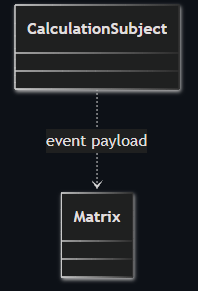
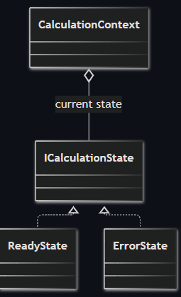
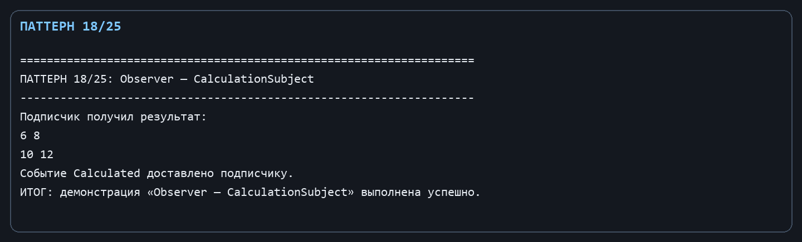
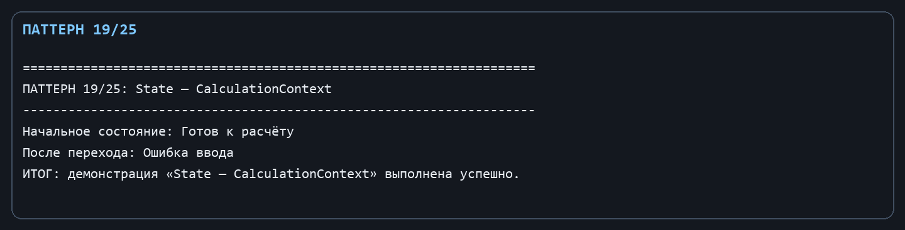

Лабораторная работа № 10. Поведенческие паттерны: Наблюдатель и Состояние

Цель: Оповещать заинтересованные компоненты о результате и явно представлять состояние процесса вычисления.

Git репозиторий - [https://github.com/DocesForg/Pattern_MatriCalculator](https://github.com/DocesForg/Pattern_MatriCalculator)

Вариант 6:  Разработка приложения «Матричный калькулятор»

Реализация и принцип работы

CalculationSubject публикует событие Calculated; наблюдатели подписываются стандартным механизмом C# event. ICalculationState задаёт состояние, конкретные ReadyState и ErrorState возвращают его имя, а CalculationContext хранит текущий объект состояния и меняет его методом SetState.

После успешной операции вызывается Notify(result), и все подписчики получают матрицу без жёсткой связи с источником. Интерфейс может переключить контекст из «Готов к расчёту» в «Ошибка ввода» объектом состояния, а не набором несогласованных булевых флагов.

На диаграмме субъект связан с данными Matrix через событие: после расчёта он уведомляет подписчиков о новом результате.

На диаграмме контекст хранит текущее состояние и может переключаться между реализациями ReadyState и ErrorState, меняя поведение в зависимости от состояния.

Полный листинг

public sealed class CalculationSubject

{

public event Action<Matrix>? Calculated;

public void Notify(Matrix result) => Calculated?.Invoke(result);

}

public interface ICalculationState { string Name { get; } }

public sealed class ReadyState : ICalculationState { public string Name => "Готов к расчёту"; }

public sealed class ErrorState : ICalculationState { public string Name => "Ошибка ввода"; }

public sealed class CalculationContext { public ICalculationState State { get; private set; } = new ReadyState(); public void SetState(ICalculationState state) => State = state; }

Вывод: В ходе выполнения лабораторной работы № 10 были реализованы поведенческие паттерны «Наблюдатель» и «Состояние». Наблюдатель обеспечил механизм оповещения заинтересованных компонентов о результатах вычислений через события. Состояние позволило объекту изменять поведение при изменении внутреннего состояния, инкапсулируя логику переходов между состояниями. Это упростило управление реактивной логикой и состоянием приложения.

