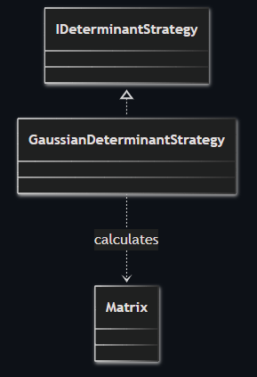
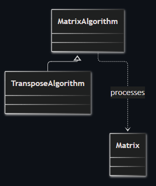
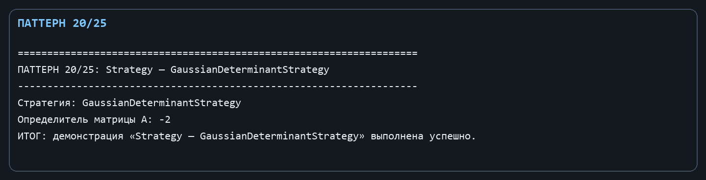
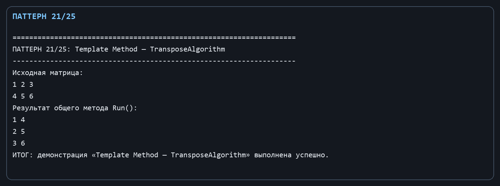

Лабораторная работа № 11. Поведенческие паттерны: Стратегия и Шаблонный метод

Цель: Дать возможность подменять алгоритм определителя и зафиксировать общий порядок матричного алгоритма.

Git репозиторий - [https://github.com/DocesForg/Pattern_MatriCalculator](https://github.com/DocesForg/Pattern_MatriCalculator)

Вариант 6:  Разработка приложения «Матричный калькулятор»

Реализация и принцип работы

IDeterminantStrategy определяет стратегию подсчёта; GaussianDeterminantStrategy использует уже проверенный алгоритм Matrix.Determinant. Абстрактный MatrixAlgorithm реализует шаблонный метод Run: сначала вызывает общий хук Validate, потом абстрактный шаг Transform. TransposeAlgorithm определяет только преобразование.

Клиент может подставить другой IDeterminantStrategy, не меняя свой код. Любой наследник MatrixAlgorithm автоматически проходит проверку на null, поэтому этот обязательный шаг не будет случайно пропущен.

На диаграмме стратегия определяет отдельный алгоритм вычисления определителя, а конкретная реализация применяет этот алгоритм к объекту Matrix.

На диаграмме базовый алгоритм задаёт общий каркас выполнения, а TransposeAlgorithm наследует его и предоставляет конкретное преобразование матрицы.

Полный листинг

public interface IDeterminantStrategy { double Calculate(Matrix matrix); }

public sealed class GaussianDeterminantStrategy : IDeterminantStrategy { public double Calculate(Matrix matrix) => matrix.Determinant(); }

public abstract class MatrixAlgorithm

{

public Matrix Run(Matrix matrix) { Validate(matrix); return Transform(matrix); }

protected virtual void Validate(Matrix matrix) => ArgumentNullException.ThrowIfNull(matrix);

protected abstract Matrix Transform(Matrix matrix);

}

public sealed class TransposeAlgorithm : MatrixAlgorithm { protected override Matrix Transform(Matrix matrix) => matrix.Transpose(); }

Вывод: В ходе выполнения лабораторной работы № 11 были реализованы поведенческие паттерны «Стратегия» и «Шаблонный метод». Стратегия позволила выбирать алгоритм вычисления определителя динамически, инкапсулируя различные реализации. Шаблонный метод зафиксировал общий скелет алгоритма, выделив изменяемые шаги в отдельные методы. Это обеспечило гибкость замены алгоритмов и предотвратило дублирование кода.

