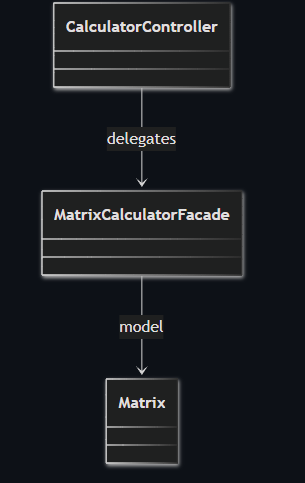
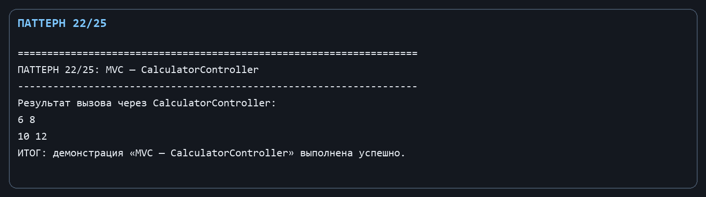

Лабораторная работа № 12. Архитектурный паттерн: MVC

Цель: Разделить консольный вид, управление сценарием и математическую модель.

Git репозиторий - [https://github.com/DocesForg/Pattern_MatriCalculator](https://github.com/DocesForg/Pattern_MatriCalculator)

Вариант 6:  Разработка приложения «Матричный калькулятор»

Реализация и принцип работы

Matrix является моделью, существующий Program.cs - представлением (View), а CalculatorController - контроллером. Он принимает текстовые параметры от представления и направляет их в фасад, не реализуя математические алгоритмы самостоятельно.

Поток вызова имеет вид Program (View) → CalculatorController → MatrixCalculatorFacade → Matrix (Model). Благодаря этому при замене консольного интерфейса контроллер и модель можно использовать повторно.

На диаграмме контроллер передаёт запрос фасаду, а фасад работает с Matrix. Таким образом показано разделение роли контроллера и модели вычислений.

*Рисунок ********1**** - **MVC*

Полный листинг

public sealed class CalculatorController(MatrixCalculatorFacade facade) // MVC controller

{ public Matrix Calculate(string left, string operation, string? right) => facade.Calculate(left, operation, right); }

*Рисунок ********2**** - **Выполнение **MVC*

Вывод: В ходе выполнения лабораторной работы № 12 был реализован архитектурный паттерн MVC (Model-View-Controller). Модель инкапсулировала математическую логику матричных операций, представление отвечало за взаимодействие с пользователем через консоль, а контроллер управлял потоком данных между ними. Это обеспечило разделение ответственности и упростило тестирование и модификацию отдельных компонентов.

