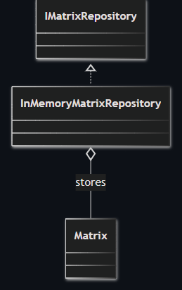
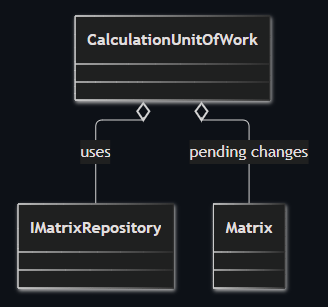
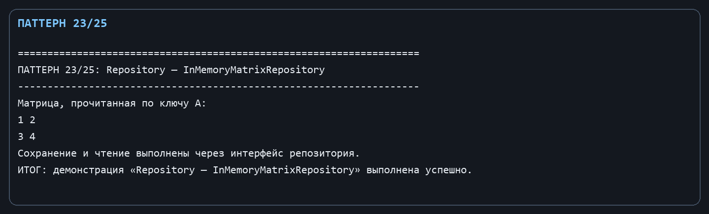
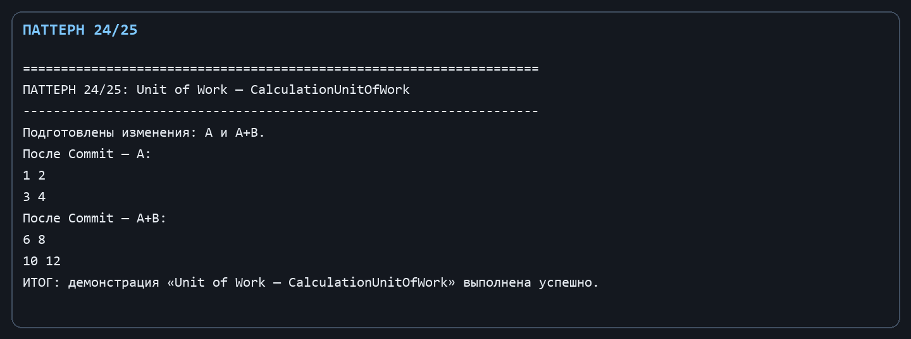

Лабораторная работа № 14. Системные паттерны: Репозиторий и Unit of Work

Цель: Отделить хранение именованных матриц от вычислительной логики и задать границу фиксации изменений.

Git репозиторий - [https://github.com/DocesForg/Pattern_MatriCalculator](https://github.com/DocesForg/Pattern_MatriCalculator)

Вариант 6:  Разработка приложения «Матричный калькулятор»

Реализация и принцип работы

IMatrixRepository - абстракция хранилища, InMemoryMatrixRepository - реализация на словаре. CalculationUnitOfWork получает репозиторий, накапливает пары имени и матрицы в _pending, а Commit сохраняет их одним логическим действием и очищает накопитель.

Калькулятор зависит от интерфейса репозитория, поэтому словарь можно заменить файлом или БД. Пока Commit не вызван, изменения остаются в единице работы; это делает момент сохранения явным.

На диаграмме конкретный репозиторий реализует интерфейс хранилища и содержит объекты Matrix, показывая отделение доступа к данным от способа их хранения.

На диаграмме Unit of Work использует репозиторий и временно содержит изменённые матрицы до момента фиксации (Commit).

Полный листинг

public interface IMatrixRepository { void Save(string name, Matrix matrix); Matrix Get(string name); }

public sealed class InMemoryMatrixRepository : IMatrixRepository

{

private readonly Dictionary<string, Matrix> _matrices = new();

public void Save(string name, Matrix matrix) => _matrices[name] = matrix;

public Matrix Get(string name) => _matrices.TryGetValue(name, out var matrix) ? matrix : throw new KeyNotFoundException(name);

}

public sealed class CalculationUnitOfWork(IMatrixRepository repository)

{

private readonly List<(string Name, Matrix Matrix)> _pending = [];

public void Add(string name, Matrix matrix) => _pending.Add((name, matrix));

public void Commit() { foreach (var item in _pending) repository.Save(item.Name, item.Matrix); _pending.Clear(); }

}

Вывод: В ходе выполнения лабораторной работы № 14 были реализованы системные паттерны «Репозиторий» и «Unit of Work». Репозиторий абстрагировал доступ к хранилищу матриц, отделив логику сохранения от бизнес-логики. Unit of Work объединил несколько операций сохранения в единую транзакцию, обеспечивая согласованность данных. Это упростило тестирование и замену механизма хранения.

