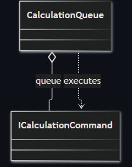
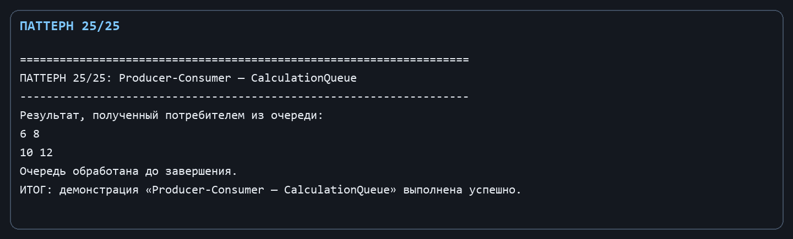

Лабораторная работа № 15. Идиоматический паттерн: Производитель-Потребитель

Цель: Организовать потокобезопасную передачу команд вычисления от производителя к потребителю.

Git репозиторий - [https://github.com/DocesForg/Pattern_MatriCalculator](https://github.com/DocesForg/Pattern_MatriCalculator)

Вариант 6:  Разработка приложения «Матричный калькулятор»

Реализация и принцип работы

CalculationQueue содержит BlockingCollection<ICalculationCommand>. Производитель передаёт задачи через Produce; потребитель перечисляет Consume, который блокируется до появления команды и выполняет её. Complete сообщает, что новые задачи больше не поступят, после чего перечисление корректно завершится.

Такое разделение позволяет формировать команды в одном потоке, а выполнять - в другом. Очередь обеспечивает безопасную синхронизацию и не требует вручную управлять блокировками.

На диаграмме очередь содержит команды: производитель помещает команды в очередь, а потребитель извлекает их и запускает выполнение.

Полный листинг

public sealed class CalculationQueue

{

private readonly BlockingCollection<ICalculationCommand> _queue = new();

public void Produce(ICalculationCommand command) => _queue.Add(command);

public IEnumerable<Matrix> Consume() => _queue.GetConsumingEnumerable().Select(command => command.Execute());

public void Complete() => _queue.CompleteAdding();

}

Вывод: В ходе выполнения лабораторной работы № 15 был реализован идиоматический паттерн «Производитель-Потребитель». Паттерн организовал потокобезопасную передачу команд вычисления между потоками через блокирующую очередь. Производитель добавлял задачи в очередь, а потребитель выполнял их по мере поступления. Это обеспечило корректную синхронизацию потоков без явного использования блокировок.

