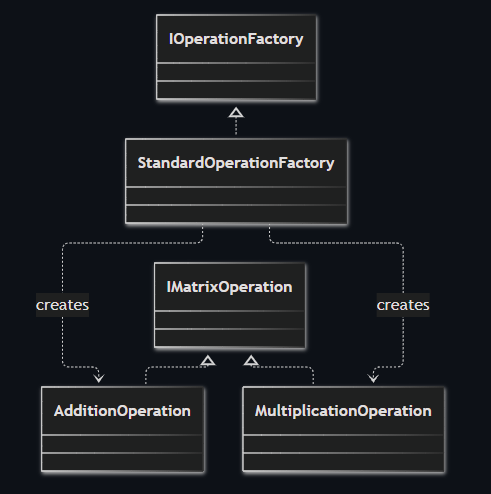
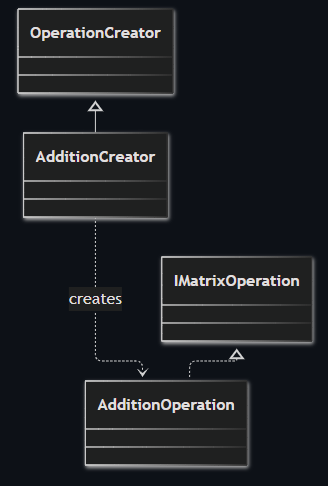
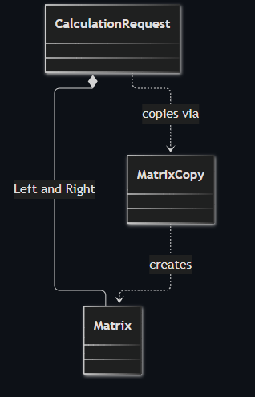
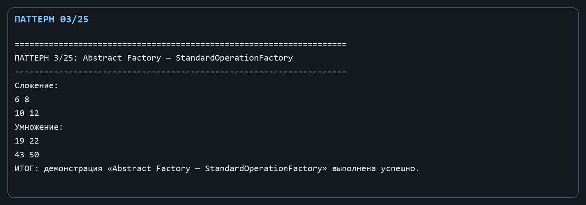
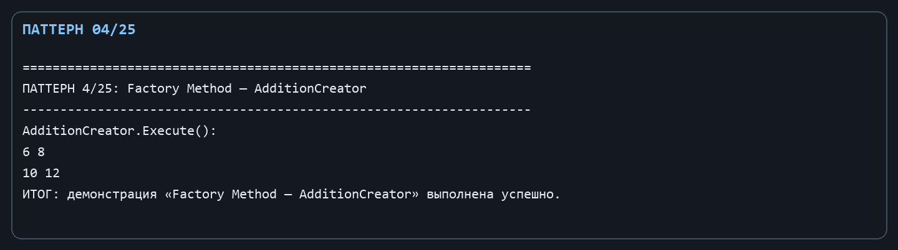
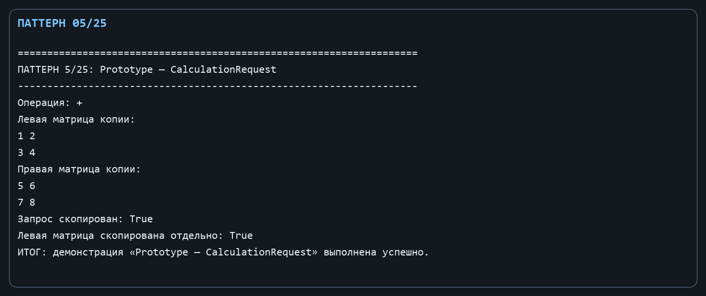

Лабораторная работа № 2. Порождающие паттерны: Абстрактная фабрика, Фабричный метод и Прототип

Цель: Отделить клиентский код от конкретных классов операций и обеспечить независимое копирование запроса на вычисление.

Git репозиторий - [https://github.com/DocesForg/Pattern_MatriCalculator](https://github.com/DocesForg/Pattern_MatriCalculator)

Вариант 6:  Разработка приложения «Матричный калькулятор»

Реализация и принцип работы

IMatrixOperation задаёт общий контракт операции. StandardOperationFactory является абстрактной фабрикой для семейства операций сложения и умножения. Базовый OperationCreator определяет фабричный метод Create, а AdditionCreator выбирает конкретный продукт. Неизменяемая запись CalculationRequest является прототипом; её Clone создаёт новые экземпляры левой и правой матриц.

Код, которому нужна операция, зависит от IOperationFactory или OperationCreator, а не от реализации сложения. Вызов Clone не оставляет две заявки с общими экземплярами операндов: вспомогательный MatrixCopy получает строковое представление и создаёт отдельную матрицу через публичный API.

На диаграмме фабрика отделена от конкретных операций: стандартная фабрика создаёт операции сложения и умножения, которые реализуют общий интерфейс.

*Рисунок ********1**** - **Abstract** Factory*

На диаграмме показано наследование от создателя к конкретному создателю: AdditionCreator использует фабричный метод для получения операции сложения.

*Рисунок ********2**** - Factory **Method*

На диаграмме запрос содержит связанные с ним матрицы, а отдельный объект копирования участвует в создании их копий. Это показывает получение независимой копии исходного запроса.

*Рисунок** ************3**** - Prototype*

Полный листинг

public interface IMatrixOperation { Matrix Apply(Matrix left, Matrix? right = null); }

public sealed class AdditionOperation : IMatrixOperation { public Matrix Apply(Matrix left, Matrix? right = null) => left.Add(right ?? throw new ArgumentNullException(nameof(right))); }

public sealed class MultiplicationOperation : IMatrixOperation { public Matrix Apply(Matrix left, Matrix? right = null) => left.Multiply(right ?? throw new ArgumentNullException(nameof(right))); }

public interface IOperationFactory { IMatrixOperation CreateAddition(); IMatrixOperation CreateMultiplication(); }

public sealed class StandardOperationFactory : IOperationFactory

{

public IMatrixOperation CreateAddition() => new AdditionOperation();

public IMatrixOperation CreateMultiplication() => new MultiplicationOperation();

}

public abstract class OperationCreator

{

public abstract IMatrixOperation Create();

public Matrix Execute(Matrix left, Matrix right) => Create().Apply(left, right);

}

public sealed class AdditionCreator : OperationCreator { public override IMatrixOperation Create() => new AdditionOperation(); }

public sealed record CalculationRequest(Matrix Left, Matrix? Right, string Operation)

{

public CalculationRequest Clone() => this with { Left = new MatrixCopy(Left).Value, Right = Right is null ? null : new MatrixCopy(Right).Value };

private sealed class MatrixCopy

{

public Matrix Value { get; }

public MatrixCopy(Matrix source) => Value = Matrix.Parse(source.ToString().Replace(Environment.NewLine, ";"));

}

}

*Рисунок ********4**** **–** Выполнение** **Abstract Factory*

*Рисунок ********5**** - **Выполнение **Factory Method*

*Рисунок ********6**** - **Выполнение **Prototype*

Вывод: В ходе выполнения лабораторной работы № 2 были реализованы порождающие паттерны «Абстрактная фабрика», «Фабричный метод» и «Прототип». Абстрактная фабрика обеспечила создание семейств связанных операций без привязки к конкретным классам. Фабричный метод позволил делегировать создание конкретных объектов подклассам, упрощая расширение функциональности. Прототип дал возможность клонирования сложных объектов запросов, обеспечивая глубокое копирование данных. Применение этих паттернов повысило гибкость системы и упростило добавление новых операций.

