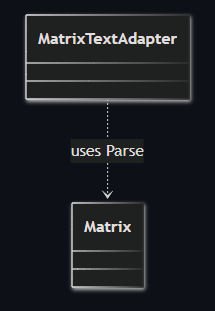
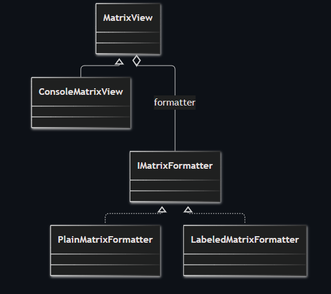
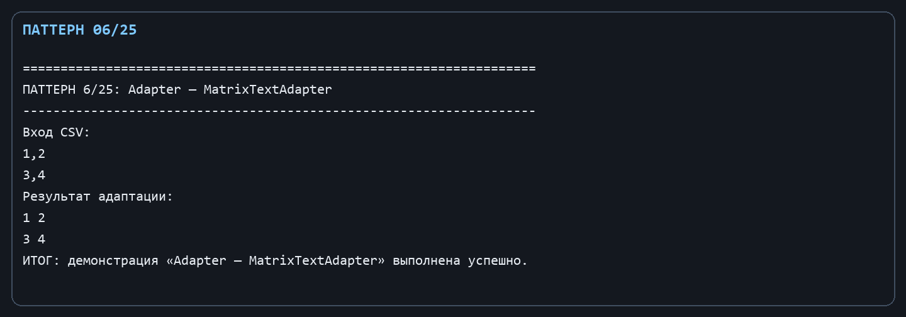
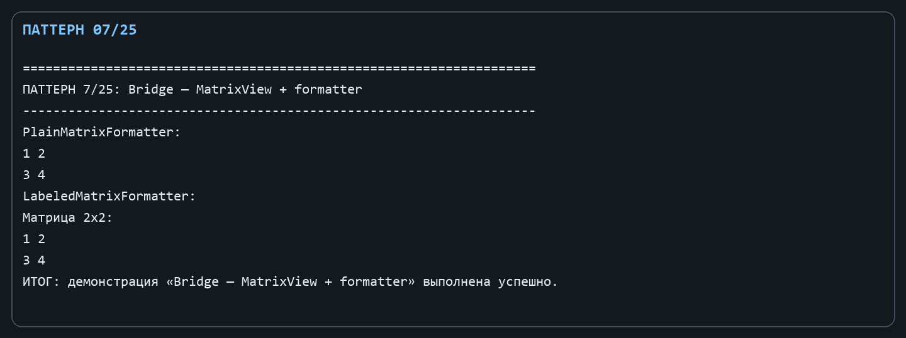

Лабораторная работа № 3. Структурные паттерны: Адаптер и Мост

Цель: Научиться принимать внешний формат матриц и независимо варьировать представление результата.

Git репозиторий - [https://github.com/DocesForg/Pattern_MatriCalculator](https://github.com/DocesForg/Pattern_MatriCalculator)

Вариант 6:  Разработка приложения «Матричный калькулятор»

Реализация и принцип работы

MatrixTextAdapter адаптирует CSV-подобный текст: заменяет переводы строк на разделитель строк матрицы и запятые на пробелы, после чего использует существующий Matrix.Parse. В паттерне «Мост» абстракция MatrixView хранит ссылку на реализацию IMatrixFormatter; ConsoleMatrixView - конкретный вид, а PlainMatrixFormatter и LabeledMatrixFormatter - взаимозаменяемые реализации форматирования.

Адаптер локализует преобразование формата и не требует изменять Matrix.Parse. При выводе вид вызывает Formatter.Format(matrix), поэтому можно добавить новый формат (например, JSON) без создания нового класса вида и наоборот.

На диаграмме адаптер связывает внешний текстовый формат с Matrix: он преобразует входные данные и передаёт их стандартному разбору матрицы.

На диаграмме абстракция представления отделена от форматтера: один и тот же MatrixView может работать с разными реализациями форматирования.

Полный листинг

public sealed class MatrixTextAdapter

{

public Matrix FromCsv(string csv) => Matrix.Parse(csv.Replace("\r", string.Empty).Replace("\n", ";").Replace(",", " "));

}

public interface IMatrixFormatter { string Format(Matrix matrix); }

public sealed class PlainMatrixFormatter : IMatrixFormatter { public string Format(Matrix matrix) => matrix.ToString(); }

public sealed class LabeledMatrixFormatter : IMatrixFormatter { public string Format(Matrix matrix) => $"Матрица {matrix.Rows}x{matrix.Columns}:{Environment.NewLine}{matrix}"; }

public abstract class MatrixView

{

protected MatrixView(IMatrixFormatter formatter) => Formatter = formatter;

protected IMatrixFormatter Formatter { get; }

public abstract string Render(Matrix matrix);

}

public sealed class ConsoleMatrixView : MatrixView

{

public ConsoleMatrixView(IMatrixFormatter formatter) : base(formatter) { }

public override string Render(Matrix matrix) => Formatter.Format(matrix);

}

Вывод: В ходе выполнения лабораторной работы № 3 были реализованы структурные паттерны «Адаптер» и «Мост». Адаптер позволил совместить несовместимые интерфейсы, обеспечив преобразование внешнего CSV-формата во внутренний формат матрицы. Паттерн «Мост» разделил абстракцию представления и реализацию форматирования, позволив независимо изменять их. Это повысило гибкость системы и упростило добавление новых форматов вывода.

