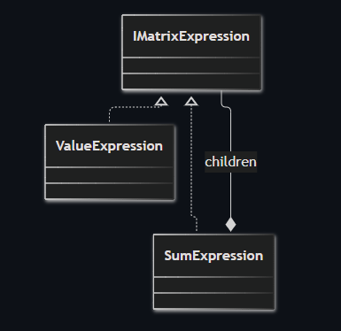
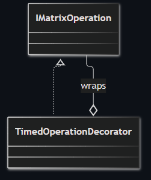
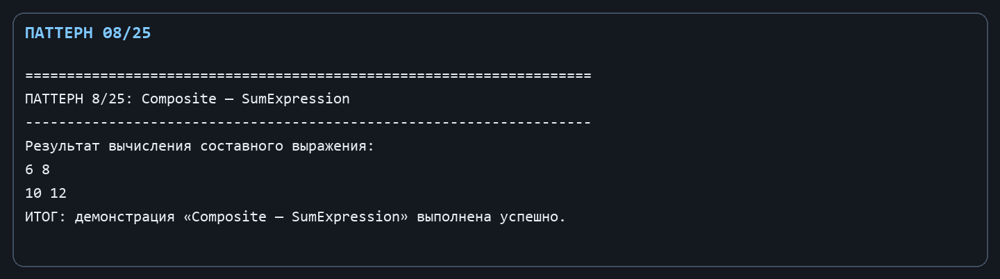
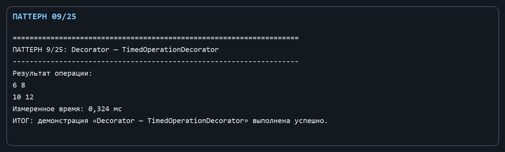

Лабораторная работа № 4. Структурные паттерны: Компоновщик и Декоратор

Цель: Составлять сложные матричные выражения из простых и добавлять измерение времени без изменения алгоритмов операций.

Git репозиторий - [https://github.com/DocesForg/Pattern_MatriCalculator](https://github.com/DocesForg/Pattern_MatriCalculator)

Вариант 6:  Разработка приложения «Матричный калькулятор»

Реализация и принцип работы

IMatrixExpression - единый интерфейс листа и композиции. ValueExpression возвращает готовую матрицу, а SumExpression содержит список дочерних выражений и складывает результаты. TimedOperationDecorator реализует тот же интерфейс IMatrixOperation, что и декорируемая операция, запускает секундомер, делегирует вычисление и сохраняет длительность в LastDuration.

Клиент может передать в SumExpression как отдельную матрицу, так и другой составной объект. Декоратор прозрачен для вызывающего кода: он получает результат исходной операции, но также может прочитать время последнего выполнения.

На диаграмме листовые и составные выражения имеют общий интерфейс, а SumExpression содержит набор дочерних выражений и объединяет их результат.

*Рисунок ********1**** - Composite*

На диаграмме декоратор реализует тот же интерфейс, что и исходная операция, и содержит её внутри, добавляя к выполнению дополнительную логику измерения времени.

*Рисунок ********2**** - Decorator*

Полный листинг

public interface IMatrixExpression { Matrix Evaluate(); }

public sealed class ValueExpression : IMatrixExpression { private readonly Matrix _value; public ValueExpression(Matrix value) => _value = value; public Matrix Evaluate() => _value; }

public sealed class SumExpression : IMatrixExpression

{

private readonly List<IMatrixExpression> _children = [];

public SumExpression Add(IMatrixExpression child) { _children.Add(child); return this; }

public Matrix Evaluate() => _children.Skip(1).Aggregate(_children.First().Evaluate(), (sum, child) => sum.Add(child.Evaluate()));

}

public sealed class TimedOperationDecorator(IMatrixOperation inner) : IMatrixOperation

{

public TimeSpan LastDuration { get; private set; }

public Matrix Apply(Matrix left, Matrix? right = null)

{

var watch = System.Diagnostics.Stopwatch.StartNew();

var result = inner.Apply(left, right);

watch.Stop(); LastDuration = watch.Elapsed;

return result;

}

}

*Рисунок ********3**** - **Выполнение **Composite*

*Рисунок ********4**** - **Выполнение **Decorator*

Вывод: В ходе выполнения лабораторной работы № 4 были реализованы структурные паттерны «Компоновщик» и «Декоратор». Компоновщик позволил единообразно работать с отдельными матрицами и сложными выражениями из нескольких операций. Декоратор добавил возможность измерения времени выполнения операций без изменения кода самих операций. Это обеспечило гибкость расширения функциональности и упростило поддержку кода.

