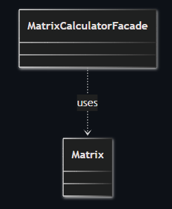
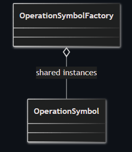
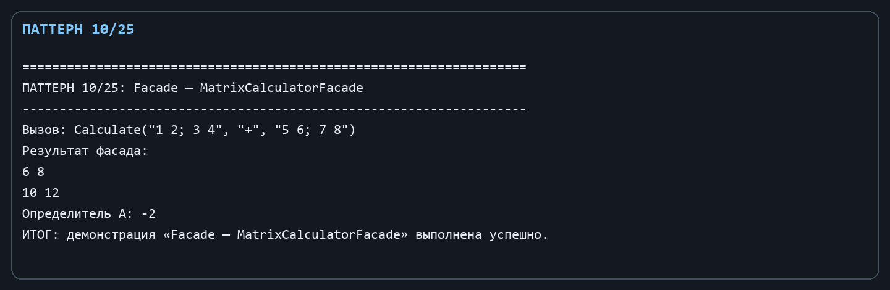
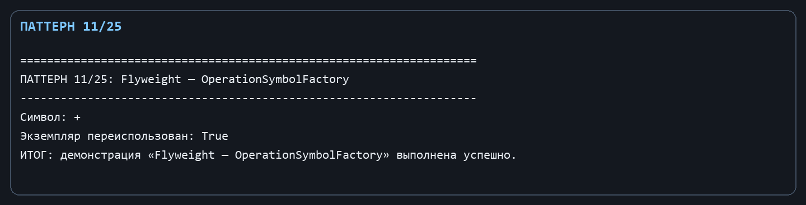

Лабораторная работа № 5. Структурные паттерны: Фасад и Приспособленец

Цель: Предоставить простой интерфейс прикладного уровня и повторно использовать общие объекты обозначений операций.

Git репозиторий - [https://github.com/DocesForg/Pattern_MatriCalculator](https://github.com/DocesForg/Pattern_MatriCalculator)

Вариант 6:  Разработка приложения «Матричный калькулятор»

Реализация и принцип работы

MatrixCalculatorFacade собирает несколько шагов подсистемы: разбирает текст, проверяет наличие второго операнда, выбирает математическую операцию и вызывает Matrix. OperationSymbolFactory хранит уже созданные OperationSymbol в словаре; сами символы имеют неизменяемое свойство Value и конструктор с внутренней видимостью.

Пользователь фасада вызывает один метод Calculate либо Determinant, не работая с разбором строк вручную. При повторном Get("+") фабрика возвращает тот же объект из _symbols, а не создаёт ещё один символ.

На диаграмме фасад напрямую обращается к Matrix и скрывает детали работы с матрицами за одним упрощённым интерфейсом.

*Рисунок ********1**** **–** **Façade*

На диаграмме фабрика хранит разделяемые экземпляры OperationSymbol, чтобы при повторном запросе использовать уже созданный объект вместо создания нового.

*Рисунок ********2**** - Flyweight*

Полный листинг

public sealed class MatrixCalculatorFacade

{

public Matrix Calculate(string left, string operation, string? right = null)

{

var first = Matrix.Parse(left);

return operation.ToLowerInvariant() switch

{

"t" => first.Transpose(), "inv" => first.Inverse(),

"+" => first.Add(Matrix.Parse(RequireRight(right))),

"-" => first.Subtract(Matrix.Parse(RequireRight(right))),

"*" => first.Multiply(Matrix.Parse(RequireRight(right))),

_ => throw new ArgumentException("Операция не возвращает матрицу или не поддерживается.")

};

}

public double Determinant(string matrix) => Matrix.Parse(matrix).Determinant();

private static string RequireRight(string? value) => value ?? throw new ArgumentException("Для бинарной операции нужна вторая матрица.");

}

public sealed class OperationSymbol

{

internal OperationSymbol(string value) => Value = value;

public string Value { get; }

}

public sealed class OperationSymbolFactory

{

private readonly Dictionary<string, OperationSymbol> _symbols = new();

public OperationSymbol Get(string value) => _symbols.TryGetValue(value, out var symbol) ? symbol : _symbols[value] = new OperationSymbol(value);

}

*Рисунок ********3**** - **Выполнение **Façade*

*Рисунок ********4**** - **Выполнение **Flyweight*

Вывод: В ходе выполнения лабораторной работы № 5 были реализованы структурные паттерны «Фасад» и «Приспособленец». Фасад предоставил простой интерфейс для сложных операций матричного калькулятора, скрыв детали реализации. Приспособленец обеспечил эффективное повторное использование объектов символов операций через кэширование. Это упростило клиентский код и оптимизировало использование памяти.

