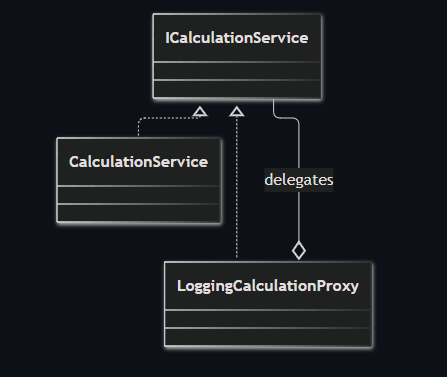
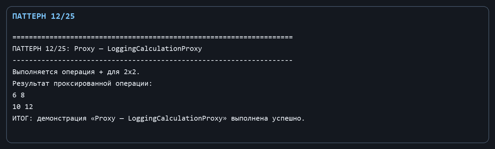

Лабораторная работа № 6. Структурный паттерн: Заместитель

Цель: Добавить журналирование доступа к вычислениям без изменения реального вычислительного сервиса.

Git репозиторий - [https://github.com/DocesForg/Pattern_MatriCalculator](https://github.com/DocesForg/Pattern_MatriCalculator)

Вариант 6:  Разработка приложения «Матричный калькулятор»

Реализация и принцип работы

ICalculationService определяет контракт. CalculationService - реальный объект, сопоставляющий символ операции с методом Matrix. LoggingCalculationProxy реализует тот же контракт, принимает реальный сервис и делегат журнала, выводит диагностическое сообщение и затем делегирует вызов реальному объекту.

Клиент использует только ICalculationService, поэтому вместо реального сервиса может подставить заместитель. В дальнейшем в точке заместителя можно добавить проверку прав, кэширование или ленивое создание без правок клиентского кода.

На диаграмме прокси и реальный сервис имеют общий интерфейс: прокси принимает вызов, добавляет логирование и передаёт выполнение реальному сервису.

*Рисунок ********1**** - **Proxy*

Полный листинг

public interface ICalculationService { Matrix Calculate(Matrix left, string operation, Matrix? right = null); }

public sealed class CalculationService : ICalculationService

{

public Matrix Calculate(Matrix left, string operation, Matrix? right = null) => operation switch

{

"+" => left.Add(right ?? throw new ArgumentNullException(nameof(right))),

"-" => left.Subtract(right ?? throw new ArgumentNullException(nameof(right))),

"*" => left.Multiply(right ?? throw new ArgumentNullException(nameof(right))),

"t" => left.Transpose(), "inv" => left.Inverse(), _ => throw new ArgumentException("Неизвестная операция.")

};

}

public sealed class LoggingCalculationProxy(ICalculationService service, Action<string> log) : ICalculationService

{

public Matrix Calculate(Matrix left, string operation, Matrix? right = null)

{

log($"Выполняется операция {operation} для {left.Rows}x{left.Columns}.");

return service.Calculate(left, operation, right);

}

}

*Рисунок ********2**** - **Выполнение **Proxy*

Вывод: В ходе выполнения лабораторной работы № 6 был реализован структурный паттерн «Заместитель». Заместитель добавил возможность журналирования операций вычисления без изменения кода реального сервиса. Это обеспечило контроль доступа к объекту и добавление дополнительной логики (логирование) прозрачно для клиента. Паттерн упростил расширение функциональности и соблюдение принципа открытости/закрытости.

