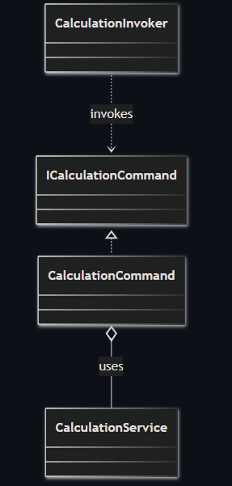
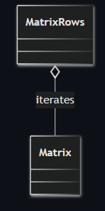
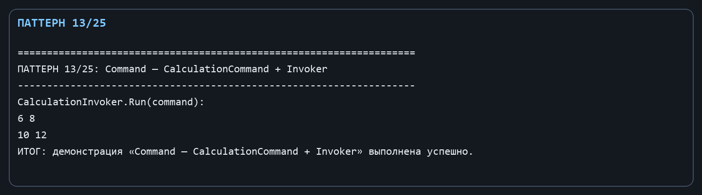
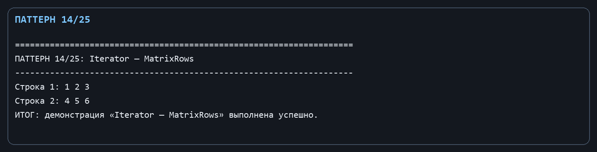

Лабораторная работа № 7. Поведенческие паттерны: Команда и Итератор

Цель: Инкапсулировать запрос вычисления и предоставить последовательный обход строк матрицы.

Git репозиторий - [https://github.com/DocesForg/Pattern_MatriCalculator](https://github.com/DocesForg/Pattern_MatriCalculator)

Вариант 6:  Разработка приложения «Матричный калькулятор»

Реализация и принцип работы

CalculationCommand содержит все данные запроса: сервис, левый и правый операнды и название операции. CalculationInvoker запускает объект команды. MatrixRows реализует IEnumerable<double[]>; его итератор создаёт для каждой строки новый массив значений, пользуясь индексатором Matrix.

Команду можно передавать в очередь, сохранять или выполнять позднее. foreach по MatrixRows не получает доступ к закрытому массиву значений модели: коллекция сама выдаёт строки по одной.

На диаграмме команда содержит сервис, который нужен для выполнения операции, а invoker запускает команду через общий метод Execute().

*Рисунок ********1**** - Command*

На диаграмме объект MatrixRows связан с матрицей и предоставляет последовательный обход её строк, скрывая детали перебора.

*Рисунок ********2**** - Iterator*

Полный листинг

public interface ICalculationCommand { Matrix Execute(); }

public sealed class CalculationCommand(ICalculationService service, Matrix left, string operation, Matrix? right) : ICalculationCommand

{ public Matrix Execute() => service.Calculate(left, operation, right); }

public sealed class CalculationInvoker { public Matrix Run(ICalculationCommand command) => command.Execute(); }

public sealed class MatrixRows(Matrix matrix) : IEnumerable<double[]>

{

public IEnumerator<double[]> GetEnumerator()

{

for (var row = 0; row < matrix.Rows; row++)

yield return Enumerable.Range(0, matrix.Columns).Select(column => matrix[row, column]).ToArray();

}

IEnumerator IEnumerable.GetEnumerator() => GetEnumerator();

}

*Рисунок ********3**** – **Выполнение **Command*

*Рисунок ********4**** - Выполнение **Iterator*

Вывод: В ходе выполнения лабораторной работы № 7 были реализованы поведенческие паттерны «Команда» и «Итератор». Команда инкапсулировала запрос вычисления как объект, что позволило параметризовать операции и управлять их выполнением. Итератор предоставил способ последовательного обхода строк матрицы без раскрытия внутренней структуры. Это упростило организацию очереди задач и работу с коллекциями данных.

