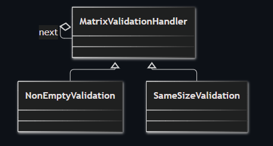
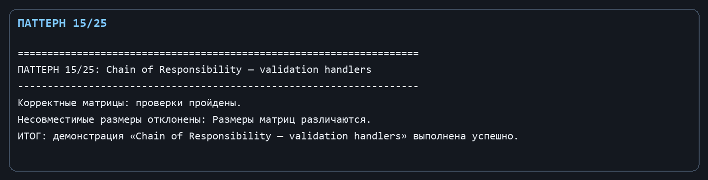

Лабораторная работа № 8. Поведенческий паттерн: Цепочка обязанностей

Цель: Разнести проверки входных данных на независимые, последовательно запускаемые обработчики.

Git репозиторий - [https://github.com/DocesForg/Pattern_MatriCalculator](https://github.com/DocesForg/Pattern_MatriCalculator)

Вариант 6:  Разработка приложения «Матричный калькулятор»

Реализация и принцип работы

Базовый MatrixValidationHandler содержит ссылку на следующий обработчик. SetNext строит цепочку, Validate сначала выполняет локальный Check, а потом передаёт данные дальше. NonEmptyValidation отвечает за непустую первую матрицу, SameSizeValidation - за равенство размеров при наличии второго операнда.

Например, new NonEmptyValidation().SetNext(new SameSizeValidation()) формирует цепочку. При ошибке обработчик выбрасывает исключение и следующий не вызывается; новое правило добавляется отдельным классом без изменения прежних.

На диаграмме валидаторы наследуются от общего обработчика и образуют цепочку через ссылку next: каждый обработчик может выполнить свою проверку и передать управление дальше.

*Рисунок** ************1**** - Chain of Responsibility*

Полный листинг

public abstract class MatrixValidationHandler

{

private MatrixValidationHandler? _next;

public MatrixValidationHandler SetNext(MatrixValidationHandler next) { _next = next; return next; }

public void Validate(Matrix left, Matrix? right) { Check(left, right); _next?.Validate(left, right); }

protected abstract void Check(Matrix left, Matrix? right);

}

public sealed class NonEmptyValidation : MatrixValidationHandler { protected override void Check(Matrix left, Matrix? right) { if (left.Rows == 0) throw new ArgumentException("Матрица пуста."); } }

public sealed class SameSizeValidation : MatrixValidationHandler { protected override void Check(Matrix left, Matrix? right) { if (right is not null && (left.Rows != right.Rows || left.Columns != right.Columns)) throw new ArgumentException("Размеры матриц различаются."); } }

*Рисунок ********2**** - Выполнение **Chain** **of** **Responsibility*

Вывод: В ходе выполнения лабораторной работы № 8 был реализован поведенческий паттерн «Цепочка обязанностей». Паттерн позволил разнести проверки входных данных на независимые обработчики, которые последовательно передают запрос по цепочке. Это обеспечило гибкость добавления новых правил валидации без изменения существующих классов и упростило поддержку кода.

