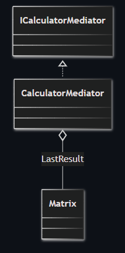
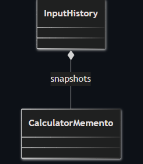
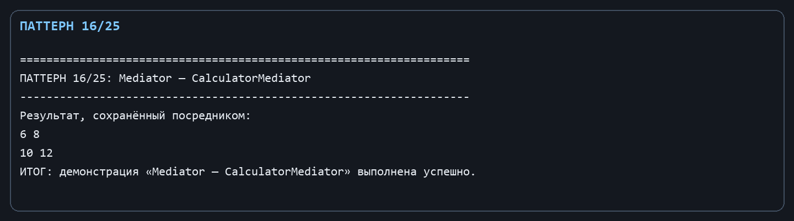
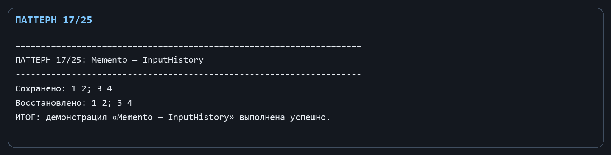

Лабораторная работа № 9. Поведенческие паттерны: Посредник и Снимок

Цель: Уменьшить прямые связи компонентов интерфейса и хранить состояние последнего пользовательского ввода.

Git репозиторий - [https://github.com/DocesForg/Pattern_MatriCalculator](https://github.com/DocesForg/Pattern_MatriCalculator)

Вариант 6:  Разработка приложения «Матричный калькулятор»

Реализация и принцип работы

ICalculatorMediator задаёт один канал публикации результата. CalculatorMediator принимает матрицу и хранит её в LastResult. Снимок представлен неизменяемой записью CalculatorMemento, а InputHistory выступает хранителем: складывает снимки в стек и возвращает последний сохранённый ввод.

Компонент-отправитель не знает, кто затем использует LastResult: он общается с посредником. При сохранении текста создаётся отдельный снимок; Restore безопасно возвращает пустую строку, если истории ещё нет.

На диаграмме посредник хранит последний результат вычисления и предоставляет общий интерфейс, через который с ним взаимодействуют клиенты.

На диаграмме история содержит снимки состояния ввода. Новые снимки добавляются в историю, а затем последний снимок может быть использован для восстановления.

Полный листинг

public interface ICalculatorMediator { void PublishResult(Matrix result); }

public sealed class CalculatorMediator : ICalculatorMediator

{

public Matrix? LastResult { get; private set; }

public void PublishResult(Matrix result) => LastResult = result;

}

public sealed record CalculatorMemento(string Input);

public sealed class InputHistory

{

private readonly Stack<CalculatorMemento> _history = new();

public void Save(string input) => _history.Push(new CalculatorMemento(input));

public string Restore() => _history.TryPeek(out var snapshot) ? snapshot.Input : string.Empty;

}

Вывод: В ходе выполнения лабораторной работы № 9 были реализованы поведенческие паттерны «Посредник» и «Снимок». Посредник уменьшил связанность компонентов, предоставив единый канал взаимодействия между ними. Снимок позволил сохранять и восстанавливать состояние калькулятора без нарушения инкапсуляции. Это упростило управление историей операций и обеспечило возможность отката действий.

